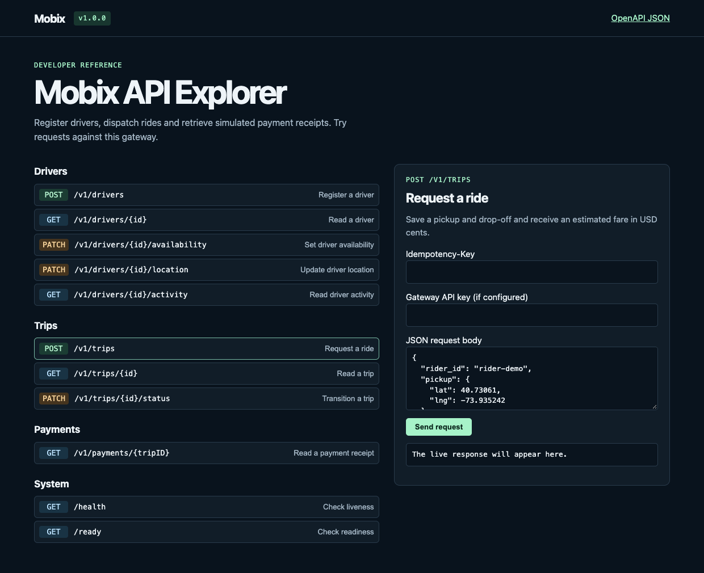

# RideMesh

[English](README.md) · [Русский](README.ru.md)

[](https://github.com/zodixdev/ridemesh/actions/workflows/ci.yml)
[](LICENSE)

RideMesh is a backend for ride dispatch written in Go. It separates account access, trip management, driver matching, and payments into small services while keeping a single HTTP entry point for clients.

The repository is intended to demonstrate the parts of a distributed backend that are easy to miss in a basic CRUD project: concurrent driver offers, idempotent state changes, authenticated real-time streams, shared rate limits, message delivery, health checks, and repeatable local and Kubernetes deployments.

> Payments are simulated. The project does not connect to a payment provider or process real money.

## Services

| Service | Responsibility |
| --- | --- |
| Gateway | Authentication, authorization, routing, rate limiting, and SSE connections |
| Trip | Trip lifecycle, fare calculation, driver dispatch, and domain events |
| Driver | Driver availability, location updates, and offer decisions |
| Payment | Idempotent payment records and receipts for completed trips |

MongoDB stores application state. Redis holds distributed rate-limit counters. RabbitMQ carries trip events between service replicas. External clients communicate with the gateway over HTTP; service-to-service requests are signed with a short-lived internal identity.


## Trip flow

1. A rider creates a trip through the gateway.
2. The trip service searches for nearby, recently active drivers.
3. Offers are sent to a small batch of candidates with an expiry time.
4. The first valid acceptance assigns the trip; late or duplicate responses are rejected safely.
5. Trip changes are published through RabbitMQ and forwarded to authorized SSE clients.
6. Completing a trip creates one payment record and exposes its receipt.

The event endpoints are:

- `GET /v1/trips/{id}/events` for riders, assigned drivers, and operators
- `GET /v1/drivers/me/offers/events` for a driver's incoming offers

Each stream starts with a current-state snapshot, uses versioned event IDs, supports `Last-Event-ID`, sends heartbeats, and closes slow or over-limit connections.


## Run locally

Requirements: Docker with Compose, GNU Make, and `curl`.

```bash
cp .env.example .env
make up
```

The gateway listens on `http://127.0.0.1:8080`. The generated API reference is available at [http://127.0.0.1:8080/docs](http://127.0.0.1:8080/docs).

Run the included scenarios after the stack becomes healthy:

```bash
make demo
make dispatch-demo
make realtime-demo
make rate-limit-demo
make verify
```

Stop the services with `make down`. Docker volumes are retained unless they are removed explicitly.

The local credentials in `.env.example` are development values. Change `RIDEMESH_INTERNAL_KEY`, the bootstrap password, MongoDB credentials, RabbitMQ credentials, and `RATE_LIMIT_KEY_SECRET` before using a shared environment.

## Public container images

The four services are published as multi-architecture images in the GitHub Container Registry:

```bash
docker pull ghcr.io/zodixdev/ridemesh:gateway
docker pull ghcr.io/zodixdev/ridemesh:trip
docker pull ghcr.io/zodixdev/ridemesh:driver
docker pull ghcr.io/zodixdev/ridemesh:payment
```

Run the complete stack from the registry without building the Go services locally:

```bash
cp .env.example .env
make up-public
```

The service tags track `main`. Every publication also creates an immutable `<service>-sha-<commit>` tag. Git tags such as `v1.2.0` additionally create `<service>-v1.2.0`. Images support `linux/amd64` and `linux/arm64` and include build provenance and an SBOM.

## API

The OpenAPI document is stored at [`api/openapi/ridemesh.json`](api/openapi/ridemesh.json). It describes authentication, rider and driver operations, operator endpoints, errors, rate-limit responses, and SSE streams.



## Tests

```bash
make check       # formatting and go vet
make build       # compile all service binaries
make test-unit   # short tests with the race detector
make test        # complete test suite; Docker is required
```

CI runs the Go checks, integration tests, Compose acceptance scenarios, broker recovery checks, and Kubernetes manifest rendering on every pull request to `main`.

## Kubernetes

The manifests use Kustomize. Render the base or the self-contained demo overlay with:

```bash
kubectl kustomize deployments/k8s/base
kubectl kustomize deployments/k8s/demo
```

`deployments/k8s/demo` includes single-instance MongoDB, Redis, and RabbitMQ workloads for evaluation. It is not a production data-plane configuration. A real deployment should use durable managed or clustered dependencies, external secret management, TLS, backups, monitoring, and an ingress appropriate for long-lived SSE connections.


## Design notes

- MongoDB is the source of truth; RabbitMQ consumers are written to tolerate redelivery.
- Payment creation and trip transitions use idempotency checks.
- Gateway rate limits are shared through Redis and fail closed when Redis is unavailable.
- SSE fan-out works across gateway replicas through RabbitMQ and enforces per-account and global connection limits.
- Dispatch uses bounded batches of nearby drivers rather than contacting candidates one at a time.
- The current internal protocol is HTTP. A possible gRPC migration is documented only as a roadmap, not as an implemented feature.

## License

Released under the [MIT License](LICENSE).
