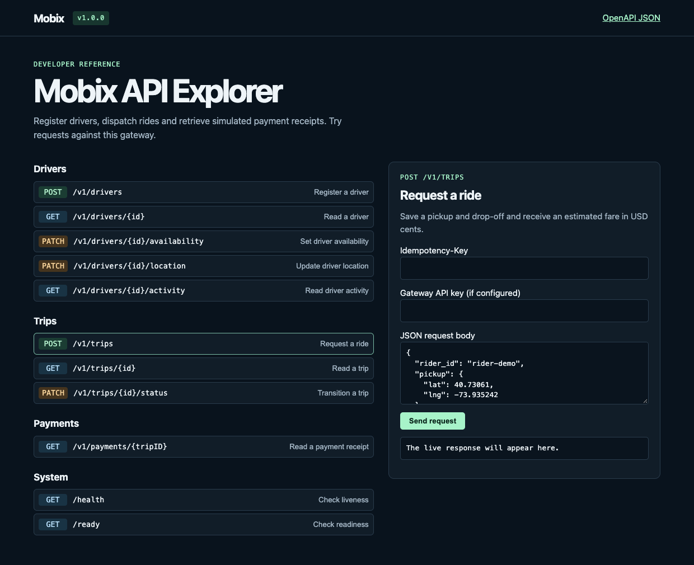

# RideMesh

[English](README.md) · [Русский](README.ru.md)

[](https://github.com/zodixdev/ridemesh/actions/workflows/ci.yml)
[](LICENSE)

RideMesh — серверная часть сервиса заказа поездок, написанная на Go. Работа с аккаунтами, поездками, подбором водителей и платежами разделена между небольшими сервисами, а клиенты обращаются к единой HTTP-точке входа.

Проект показывает задачи, которые обычно остаются за пределами простого CRUD-приложения: параллельные предложения водителям, идемпотентные изменения состояния, авторизованные потоки событий, общие лимиты запросов, доставку сообщений, проверки готовности и воспроизводимый запуск в Docker Compose и Kubernetes.

> Платежи имитируются. Проект не подключен к платежному провайдеру и не обрабатывает реальные деньги.

## Сервисы

| Сервис | Ответственность |
| --- | --- |
| Gateway | Аутентификация, авторизация, маршрутизация, rate limiting и SSE-соединения |
| Trip | Жизненный цикл поездки, расчет стоимости, подбор водителя и доменные события |
| Driver | Доступность и координаты водителя, обработка предложений |
| Payment | Идемпотентные записи о платежах и чеки завершенных поездок |

MongoDB хранит состояние приложения. Redis используется для распределенных счетчиков rate limit. RabbitMQ передает события поездок между экземплярами сервисов. Внешние клиенты работают с gateway по HTTP, а межсервисные запросы подписываются краткоживущей внутренней идентификацией.


## Как проходит поездка

1. Пассажир создает поездку через gateway.
2. Trip выбирает ближайших водителей с актуальными координатами.
3. Небольшая группа кандидатов одновременно получает предложения с ограниченным сроком действия.
4. Поездка назначается первому корректному ответу; опоздавшие и повторные ответы безопасно отклоняются.
5. Изменения публикуются через RabbitMQ и передаются авторизованным SSE-клиентам.
6. После завершения поездки создается одна запись о платеже и становится доступен чек.

Потоки событий доступны по адресам:

- `GET /v1/trips/{id}/events` — для пассажира, назначенного водителя и оператора
- `GET /v1/drivers/me/offers/events` — для предложений конкретному водителю

Каждое соединение начинается со снимка текущего состояния. События имеют версии и идентификаторы, поддерживается `Last-Event-ID`, отправляются heartbeat-сообщения, а медленные и превысившие лимит соединения закрываются.


## Локальный запуск

Понадобятся Docker с Compose, GNU Make и `curl`.

```bash
cp .env.example .env
make up
```

Gateway будет доступен по адресу `http://127.0.0.1:8080`, документация API — по адресу [http://127.0.0.1:8080/docs](http://127.0.0.1:8080/docs).

После запуска можно выполнить готовые сценарии:

```bash
make demo
make dispatch-demo
make realtime-demo
make rate-limit-demo
make verify
```

Команда `make down` останавливает сервисы, сохраняя Docker volumes.

Значения из `.env.example` предназначены только для локальной разработки. Перед запуском в общей среде необходимо заменить `RIDEMESH_INTERNAL_KEY`, пароль bootstrap-пользователя, реквизиты MongoDB и RabbitMQ, а также `RATE_LIMIT_KEY_SECRET`.

## API

Спецификация OpenAPI находится в файле [`api/openapi/ridemesh.json`](api/openapi/ridemesh.json). В ней описаны аутентификация, операции пассажира и водителя, методы оператора, ошибки, ответы rate limiter и SSE-потоки.



## Проверки

```bash
make check       # форматирование и go vet
make build       # сборка всех сервисов
make test-unit   # короткие тесты с race detector
make test        # полный набор тестов; требуется Docker
```

CI проверяет Go-код, интеграционные тесты, сценарии в Docker Compose, восстановление после сбоя брокера и рендеринг Kubernetes-манифестов для каждого pull request в `main`.

## Kubernetes

Манифесты собраны с помощью Kustomize:

```bash
kubectl kustomize deployments/k8s/base
kubectl kustomize deployments/k8s/demo
```

Окружение `deployments/k8s/demo` содержит одиночные экземпляры MongoDB, Redis и RabbitMQ и подходит только для проверки проекта. Для реальной эксплуатации нужны отказоустойчивые хранилища, внешнее управление секретами, TLS, резервное копирование, мониторинг и ingress с поддержкой долгоживущих SSE-соединений.


## Технические решения

- Источником достоверного состояния служит MongoDB; обработчики RabbitMQ учитывают повторную доставку.
- Создание платежа и переходы между состояниями поездки защищены проверками идемпотентности.
- Gateway хранит общие счетчики rate limit в Redis и запрещает запрос при недоступности Redis.
- События SSE передаются между репликами gateway через RabbitMQ; действуют общие и пользовательские лимиты соединений.
- Подбор водителя выполняется ограниченными группами ближайших кандидатов, а не последовательным опросом по одному.
- Сейчас межсервисный протокол — HTTP. Переход на gRPC описан только как возможное развитие и пока не реализован.

## Лицензия

Проект распространяется по [лицензии MIT](LICENSE).
